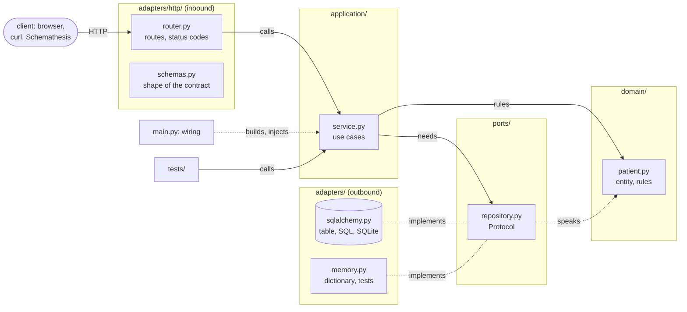

# Clinic service — Patients and appointments

The first service of the clinic. It must honor the contract `contracts/clinic.openapi.yaml`.

```bash
cd services/clinic                                # root venv activated (root README.md)
uvicorn app.main:app --reload                     # http://localhost:8000, documentation on /docs
```

Day 1: the Patients feature is provided as a complete example (`app/patients/`, with its tests); the
Appointments feature is yours to write on the same model, contract first
(`exercises/d1-afternoon/README.md`).

## The architecture

Hexagonal: the business rules sit in the middle and know nothing of HTTP or SQL; the framework and the
database are adapters plugged around them. Dependencies point inward, never outward; `main.py` is the
only file that knows every layer. The folders say the layers:

```
app/patients/
├── domain/        patient.py      the entity (a dataclass) and its rules; no framework, nothing from outside
├── ports/         repository.py   PatientRepository, a Protocol: what the use cases need from storage
├── application/   service.py     PatientService, one use case per method, written against the ports
└── adapters/
    ├── http/      schemas.py, router.py   inbound: the contract's shapes and routes, driving the use cases
    ├── sqlalchemy.py                      outbound: the table and the repository behind the port
    └── memory.py                          outbound: the same port with a dictionary, for the tests
```



| Layer | Folder, per feature | Holds | May import |
|---|---|---|---|
| domain | `domain/` | the entity, its rules | `shared/domain` only |
| ports | `ports/` | the Protocols the use cases need from the outside | the domain |
| application | `application/` | the use cases | domain, ports |
| adapters | `adapters/http/`, `adapters/sqlalchemy.py`, `adapters/memory.py` | HTTP in; SQL and memory out | everything inside |
| wiring | `app/main.py` | builds the adapters, injects them into the services | everything |

`shared/` follows the same split: `shared/domain/` (errors, identifiers, pages, instants), `shared/ports/`
(the clock), `shared/adapters/` (the clocks, the database session, and `http/` with Problem Details,
cursors and validation rules).

- `domain/patient.py`: the entity (a dataclass) and its business rules (plain functions raising
  `InvalidData`). Imports nothing from FastAPI, Pydantic or SQLAlchemy.
- `ports/repository.py`: the **port**, a `Protocol` saying what the use cases need from storage. Two
  adapters implement it.
- `application/service.py`: the use cases, one method per operation. Receives its ports by constructor;
  raises the domain errors `NotFound`, `Conflict`, `InvalidData`.
- `adapters/http/schemas.py` and `router.py`: the inbound adapter. Pydantic checks the shape of the
  contract (types, lengths, patterns, unknown fields); the router turns an HTTP request into a use case
  call and the result into a representation. No business rule here.
- `adapters/sqlalchemy.py`: the outbound adapter. The table and the SQLAlchemy implementation of the port;
  each method is one unit of work. Only here do instants lose and regain their time zone (UTC). No
  business rule here either.
- `adapters/memory.py`: the same port in a dictionary. The tests run the use cases and the rules against
  it, without HTTP and without a database, in a fraction of a second.
- `main.py`: the composition root, the only file that knows every layer. It builds the adapters, injects
  them into the services and hands the services to the routers through `app.state`.

One package per business feature (`patients/`, `appointments/`), the layers as folders inside it. A
business rule written in an adapter is a mistake, even if it works; `lint-imports` says so: the contracts
in `pyproject.toml` (import-linter) are red when a domain, a port or a use case imports a framework or an
adapter. Add your feature's package to their lists.

## The files

| File | Layer | Role |
|---|---|---|
| `app/main.py` | wiring | CORS for a browser client, schema creation at startup, wiring, `/health` |
| `app/config.py` | configuration | from the environment: `DATABASE_URL`, `ALLOWED_ORIGINS` |
| `app/shared/domain/errors.py` | domain | `NotFound`, `Conflict`, `InvalidData(field, message)`: what a use case can refuse |
| `app/shared/domain/instants.py` | domain | everything in UTC, the supported years |
| `app/shared/domain/ids.py` | domain | opaque identifiers assigned by the server |
| `app/shared/domain/page.py` | domain | `Page(items, has_more)`: what a list use case returns |
| `app/shared/ports/clock.py` | port | `Clock`: the use cases ask what time it is |
| `app/shared/adapters/clock.py` | adapter | the system clock; a fixed clock for the tests |
| `app/shared/adapters/db.py` | adapter | the SQLAlchemy engine, the session factory, the declarative base |
| `app/shared/adapters/http/problems.py` | inbound adapter | a single error format, Problem Details (RFC 9457); maps the domain errors to 404, 409, 422 |
| `app/shared/adapters/http/pagination.py` | inbound adapter | the opaque cursor of the lists |
| `app/shared/adapters/http/validation.py` | inbound adapter | the strictness rules of the contract shared by every input model |
| `app/patients/` | feature | `domain/`, `ports/`, `application/`, `adapters/`: complete, the example |
| `app/appointments/` | feature | to create: the same folders |
| `tests/conftest.py` | tests | fixtures: the memory adapters and a fixed clock |
| `tests/test_*_service.py` | tests | the use cases and the business rules, without a database |

Rules the code applies: `400` when the body or the cursor cannot be read; `422` when it can be read but
validation rejects it, type included, or when a business rule refuses it (`errors[].field` names the
field); `404` on an unknown identifier; `409` on a conflict with the current state; a `Location` on
every `201`; an absent field rather than `null`; `405` with the `Allow` header when the method does not
exist on a path; no redirect on a trailing `/`. Every route declares its errors
(`responses=responses(...)`) so that `/docs` says the same thing as the written contract, which remains
the reference.

## Test

```bash
cd services/clinic                                # venv with requirements-dev.txt
python -m pytest -q                               # the use cases, against the memory adapters
lint-imports                                      # the layers: dependencies point inward
```

## Verify against the contract

```bash
cd ../..   # repo root, venv activated, the service running in another terminal
schemathesis run contracts/clinic.openapi.yaml --url http://localhost:8000 \
  --checks not_a_server_error,status_code_conformance,content_type_conformance,response_schema_conformance
```
